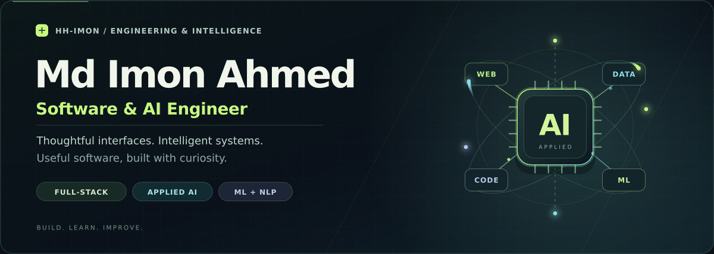
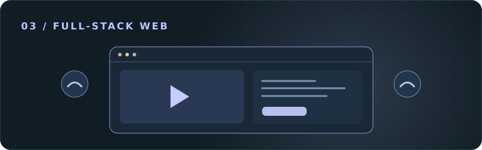

<!--
  GitHub profile: https://github.com/HH-IMON
  Upload this README.md and the entire assets/ folder to the public HH-IMON repository.
  Full setup instructions are in SETUP.md. All graphics are included locally.
  Animated GIFs and every visual switch automatically between GitHub light and dark themes.
-->

  <picture>
    <source media="(prefers-color-scheme: dark)" srcset="./assets/themes/dark/hero.gif" />
    <source media="(prefers-color-scheme: light)" srcset="./assets/themes/light/hero.gif" />
    
  </picture>

<h3 align="center">Full-Stack Developer · ML &amp; NLP Enthusiast · Problem Solver</h3>

  👋 I turn ideas into thoughtful interfaces and practical AI-powered applications.

  <a href="https://github.com/HH-IMON?tab=repositories"><picture>
    <source media="(prefers-color-scheme: dark)" srcset="./assets/themes/dark/projects.svg" />
    <source media="(prefers-color-scheme: light)" srcset="./assets/themes/light/projects.svg" />
    
  </picture></a>
  <a href="https://www.linkedin.com/in/hhimon22/"><picture>
    <source media="(prefers-color-scheme: dark)" srcset="./assets/themes/dark/linkedin.svg" />
    <source media="(prefers-color-scheme: light)" srcset="./assets/themes/light/linkedin.svg" />
    
  </picture></a>

---

## 🧑‍💻 A little about me

I'm **Md Imon Ahmed**, focused on **full-stack software development and applied AI**. I enjoy connecting intuitive interfaces, useful APIs, and machine learning to solve practical problems.

- 🎓 Studying **Computer Science & Engineering** at **Green University of Bangladesh**.
- 💻 Building with **JavaScript, React, Python, Flask, and FastAPI**.
- 🧠 Exploring **retrieval-augmented generation (RAG), NLP, and AI workflows**.
- 🔬 Interested in **multilingual AI, network security, and collaborative learning platforms**.
- 🤝 Open to collaborating on **web applications, AI-powered tools, and open-source projects**.

> **My approach:** Understand the problem. Build with care. Learn from the result.

## 🛠️ Technologies I work with

**Frontend & interfaces**

  <picture>
    <source media="(prefers-color-scheme: dark)" srcset="./assets/themes/dark/badges/html5.svg" />
    <source media="(prefers-color-scheme: light)" srcset="./assets/themes/light/badges/html5.svg" />
    
  </picture>
  <picture>
    <source media="(prefers-color-scheme: dark)" srcset="./assets/themes/dark/badges/css3.svg" />
    <source media="(prefers-color-scheme: light)" srcset="./assets/themes/light/badges/css3.svg" />
    
  </picture>
  <picture>
    <source media="(prefers-color-scheme: dark)" srcset="./assets/themes/dark/badges/javascript.svg" />
    <source media="(prefers-color-scheme: light)" srcset="./assets/themes/light/badges/javascript.svg" />
    
  </picture>
  <picture>
    <source media="(prefers-color-scheme: dark)" srcset="./assets/themes/dark/badges/react.svg" />
    <source media="(prefers-color-scheme: light)" srcset="./assets/themes/light/badges/react.svg" />
    
  </picture>
  <picture>
    <source media="(prefers-color-scheme: dark)" srcset="./assets/themes/dark/badges/tailwind.svg" />
    <source media="(prefers-color-scheme: light)" srcset="./assets/themes/light/badges/tailwind.svg" />
    
  </picture>

**Backend & databases**

  <picture>
    <source media="(prefers-color-scheme: dark)" srcset="./assets/themes/dark/badges/python.svg" />
    <source media="(prefers-color-scheme: light)" srcset="./assets/themes/light/badges/python.svg" />
    
  </picture>
  <picture>
    <source media="(prefers-color-scheme: dark)" srcset="./assets/themes/dark/badges/flask.svg" />
    <source media="(prefers-color-scheme: light)" srcset="./assets/themes/light/badges/flask.svg" />
    
  </picture>
  <picture>
    <source media="(prefers-color-scheme: dark)" srcset="./assets/themes/dark/badges/fastapi.svg" />
    <source media="(prefers-color-scheme: light)" srcset="./assets/themes/light/badges/fastapi.svg" />
    
  </picture>
  <picture>
    <source media="(prefers-color-scheme: dark)" srcset="./assets/themes/dark/badges/mysql.svg" />
    <source media="(prefers-color-scheme: light)" srcset="./assets/themes/light/badges/mysql.svg" />
    
  </picture>
  <picture>
    <source media="(prefers-color-scheme: dark)" srcset="./assets/themes/dark/badges/postgresql.svg" />
    <source media="(prefers-color-scheme: light)" srcset="./assets/themes/light/badges/postgresql.svg" />
    
  </picture>

**Machine learning & developer tools**

  <picture>
    <source media="(prefers-color-scheme: dark)" srcset="./assets/themes/dark/badges/scikit-learn.svg" />
    <source media="(prefers-color-scheme: light)" srcset="./assets/themes/light/badges/scikit-learn.svg" />
    
  </picture>
  <picture>
    <source media="(prefers-color-scheme: dark)" srcset="./assets/themes/dark/badges/pandas.svg" />
    <source media="(prefers-color-scheme: light)" srcset="./assets/themes/light/badges/pandas.svg" />
    
  </picture>
  <picture>
    <source media="(prefers-color-scheme: dark)" srcset="./assets/themes/dark/badges/git.svg" />
    <source media="(prefers-color-scheme: light)" srcset="./assets/themes/light/badges/git.svg" />
    
  </picture>
  <picture>
    <source media="(prefers-color-scheme: dark)" srcset="./assets/themes/dark/badges/github.svg" />
    <source media="(prefers-color-scheme: light)" srcset="./assets/themes/light/badges/github.svg" />
    
  </picture>

## 🚀 Selected projects

<table>
  <tr>
    <td width="50%" valign="top">
      <a href="https://github.com/HH-IMON/mediag-bd"><picture>
    <source media="(prefers-color-scheme: dark)" srcset="./assets/themes/dark/projects/medirag.svg" />
    <source media="(prefers-color-scheme: light)" srcset="./assets/themes/light/projects/medirag.svg" />
    
  </picture></a>
      <h3>🌐 MediRAG-BD</h3>
      
A multilingual medical Q&amp;A research project exploring retrieval for Bangla, Banglish, English, and mixed-language questions.

      
<code>React</code> <code>FastAPI</code> <code>FAISS</code>

      
<a href="https://github.com/HH-IMON/mediag-bd"><b>Explore the repository →</b></a>

    </td>
    <td width="50%" valign="top">
      <a href="https://github.com/HH-IMON/Deepguard-NIDS"><picture>
    <source media="(prefers-color-scheme: dark)" srcset="./assets/themes/dark/projects/deepguard.svg" />
    <source media="(prefers-color-scheme: light)" srcset="./assets/themes/light/projects/deepguard.svg" />
    
  </picture></a>
      <h3>🛡️ DeepGuard-NIDS</h3>
      
A machine-learning project investigating network intrusion detection and the classification of suspicious network activity.

      
<code>Python</code> <code>Random Forest</code> <code>XGBoost</code>

      
<a href="https://github.com/HH-IMON/Deepguard-NIDS"><b>Explore the repository →</b></a>

    </td>
  </tr>
  <tr>
    <td width="50%" valign="top">
      <a href="https://github.com/HH-IMON/Virtual-Classroom"><picture>
    <source media="(prefers-color-scheme: dark)" srcset="./assets/themes/dark/projects/classroom.svg" />
    <source media="(prefers-color-scheme: light)" srcset="./assets/themes/light/projects/classroom.svg" />
    
  </picture></a>
      <h3>🎓 Virtual Classroom</h3>
      
An interactive learning platform bringing together real-time collaboration, quizzes, assignments, and an AI teaching assistant.

      
<code>Python</code> <code>Flask</code> <code>Socket.IO</code> <code>Gemini API</code>

      
<a href="https://github.com/HH-IMON/Virtual-Classroom"><b>Explore the repository →</b></a>

    </td>
    <td width="50%" valign="top">
      <a href="https://github.com/HH-IMON/secure_file_sharing"><picture>
    <source media="(prefers-color-scheme: dark)" srcset="./assets/themes/dark/projects/secure-files.svg" />
    <source media="(prefers-color-scheme: light)" srcset="./assets/themes/light/projects/secure-files.svg" />
    
  </picture></a>
      <h3>🔐 Secure File Sharing</h3>
      
An educational application exploring encrypted file exchange, digital signatures, access control, and audit logging.

      
<code>Flask</code> <code>MySQL</code> <code>AES-GCM</code> <code>RSA</code>

      
<a href="https://github.com/HH-IMON/secure_file_sharing"><b>Explore the repository →</b></a>

    </td>
  </tr>
</table>

## 🌱 What I'm exploring next

- **AI-powered products:** Connecting useful interfaces with retrieval and AI workflows.
- **Language technology:** Understanding multilingual text and Bengali NLP.
- **Software craftsmanship:** Improving accessibility, API design, and maintainability.

## 🤝 Let's connect

Have an interesting idea or a project we could build together? I'd love to connect with developers, researchers, and teams working on useful software.

  <a href="https://www.linkedin.com/in/hhimon22/"><picture>
    <source media="(prefers-color-scheme: dark)" srcset="./assets/themes/dark/linkedin.svg" />
    <source media="(prefers-color-scheme: light)" srcset="./assets/themes/light/linkedin.svg" />
    
  </picture></a>
  <a href="https://github.com/HH-IMON?tab=repositories"><picture>
    <source media="(prefers-color-scheme: dark)" srcset="./assets/themes/dark/projects.svg" />
    <source media="(prefers-color-scheme: light)" srcset="./assets/themes/light/projects.svg" />
    
  </picture></a>

  <picture>
    <source media="(prefers-color-scheme: dark)" srcset="./assets/themes/dark/footer.gif" />
    <source media="(prefers-color-scheme: light)" srcset="./assets/themes/light/footer.gif" />
    
  </picture>

💚 Built with curiosity. Improved through practice.

